# Manuel d’adoq QDA 0.4.3


_Version Markdown complète du manuel. La version en ligne contient les mêmes pages._


## Qu’est-ce qu’adoq QDA ?

**adoq QDA** (*Analyse de données qualitatives*) est un logiciel conçu pour **apprendre le codage qualitatif d’entretiens**. Il est pensé pour les étudiant·es et leurs enseignant·es : on y importe ses retranscriptions, on surligne des passages, on leur attribue des codes, on organise ces codes en arbre et on compare son codage avec celui d’un·e collègue. Ce sont les gestes de base de l’analyse qualitative assistée par ordinateur, réunis dans un outil volontairement simple.

> **Un outil pour apprendre** — adoq QDA est optimisé pour l’apprentissage et l’enseignement : il se prend en main en quelques minutes, tient dans un seul fichier et aide l’enseignant·e à suivre le travail d’un groupe. Il est sans doute assez robuste pour un corpus important, puisque plusieurs centaines d’entretiens s’ouvrent en quelques secondes. Il n’est pourtant **pas recommandé pour l’analyse de grands corpus par des équipes de recherche professionnelles**, qui ont besoin de fonctions qu’il laisse volontairement de côté : travail simultané sur un même projet, gestion des droits d’accès, codage de sons et de vidéos, requêtes avancées.

Toute l’application tient dans **un seul fichier HTML**. Il n’y a rien à installer : un double-clic l’ouvre dans le navigateur, elle fonctionne hors ligne et **aucune donnée n’est envoyée sur internet**.

[⬇ Télécharger adoq QDA 0.4.3](adoq-QDA-0.4.3.html)

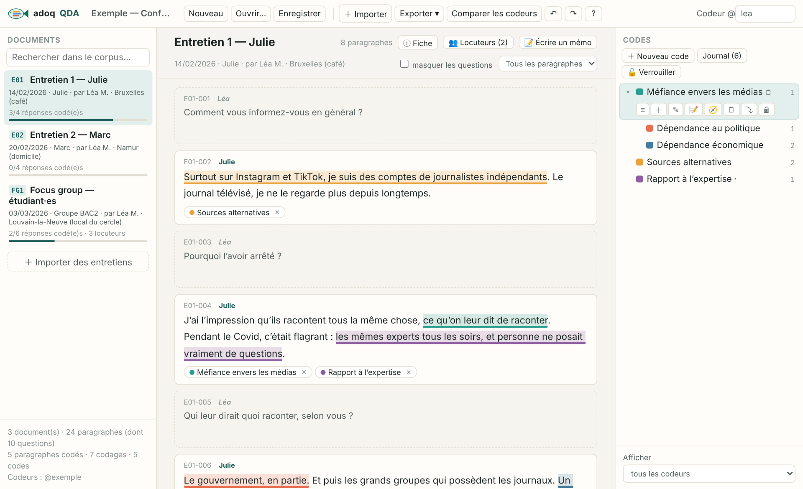

### adoq QDA peut vous aider si vous…

- découvrez l’analyse qualitative et voulez apprendre à **coder des entretiens** sans investir dans un logiciel payant ;
- préparez un **mémoire** avec une dizaine ou une trentaine d’entretiens ;
- devez **coder à deux** et mesurer votre accord (kappa de Cohen), puis construire un codage de consensus ;
- travaillez sur des **focus groups** et voulez savoir qui mobilise quels thèmes ;
- enseignez la méthode et voulez **suivre le travail d’un groupe** d’étudiant·es.

### Ce qui le distingue

- **Un projet = un fichier texte** (`.qda.md`) lisible dans n’importe quel éditeur : le codage n’est pas enfermé dans une boîte noire, on voit exactement ce qui a été noté. C’est le fichier que l’on enregistre, copie, sauvegarde et rend à son enseignant·e.
- **Les questions et les réponses sont distinguées**, les locuteurs ont un pseudo et des caractéristiques (âge, genre, profession…).
- **La construction de la grille d’analyse est tracée** : chaque création, fusion ou déplacement de code est noté dans un journal, avec son motif.

### Un logiciel libre, un format ouvert

adoq QDA est créé par **Grégoire Lits**, chercheur au **Media Innovation and Intelligibility Lab (MiiL)** de l’UCLouvain. Il est publié sous licence libre **EUPL-1.2** (*European Union Public Licence*, version 1.2).

- Code source de l’application : [github.com/MiiL-UCLouvain/adoqQDA](https://github.com/MiiL-UCLouvain/adoqQDA)
- Format qda.md : [github.com/MiiL-UCLouvain/qdamd-format](https://github.com/MiiL-UCLouvain/qdamd-format) — pourquoi ce format, voir Le fichier projet
- Pour citer adoq QDA et le format : voir À propos, licence et citation

### Comment commencer ?

1. Installer et ouvrir l’application — deux minutes.
2. Prise en main rapide avec le projet d’exemple — dix minutes.
3. Préparer vos retranscriptions avant de les importer.

> **Version** — Ce manuel décrit la version **0.4.3** (novembre 2026). Depuis la 0.4, adoq QDA adopte le **format qda.md** (version 1), commun avec QDA-md. Jusqu’à la version 0.2.2, adoq QDA s’appelait **QDA-md Étude** ; les projets créés avant la 0.4 sont convertis à l’ouverture (voir Le fichier projet). C’est la version pédagogique de QDA-md, un outil de codage qualitatif pour la recherche.


---


## Installer et ouvrir

### Télécharger

Téléchargez le fichier [`adoq-QDA-0.4.3.html`](adoq-QDA-0.4.3.html) (le numéro de version fait partie du nom) et rangez-le dans un dossier de votre ordinateur, par exemple le dossier de votre mémoire. **C’est tout** : il n’y a ni programme à installer, ni compte à créer, ni connexion nécessaire.

Pour ouvrir l’application, **double-cliquez sur le fichier** : il s’ouvre dans votre navigateur.

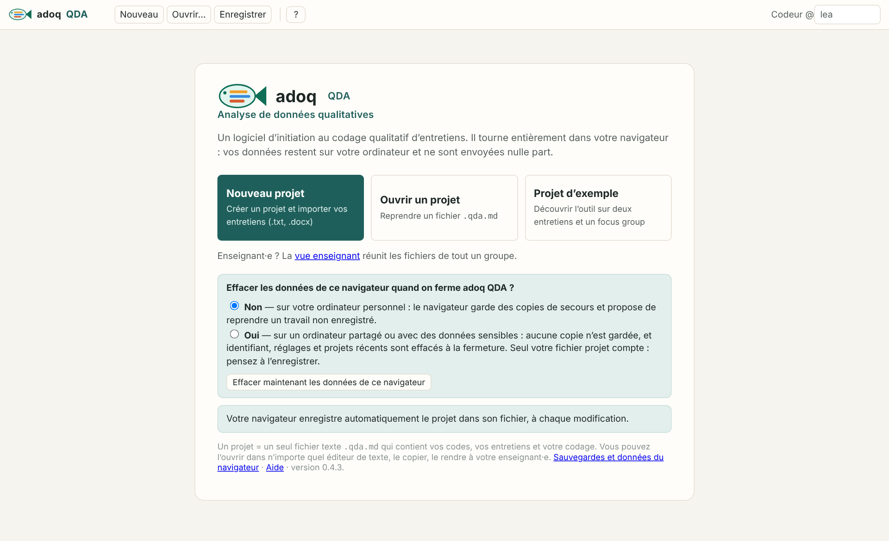

### Quel navigateur ?

L’application fonctionne dans tous les navigateurs récents, mais **l’enregistrement diffère** :

| Navigateur | Enregistrement |
|---|---|
| **Chrome, Edge** (Windows, Mac, Linux) | **Automatique** : vous choisissez une fois où ranger le fichier projet, puis chaque modification y est enregistrée en une seconde. |
| **Firefox, Safari** | **Manuel** : cliquez sur « Enregistrer » (ou `Ctrl+S` / `Cmd+S`). Le projet est téléchargé dans votre dossier Téléchargements. Pour reprendre, rouvrez le **dernier** fichier téléchargé. |

> **Conseil** — Utilisez **Chrome ou Edge** pour un travail de longue haleine comme un mémoire : l’enregistrement automatique évite de se retrouver avec `projet (1).qda.md`, `projet (2).qda.md`…

> **Ordinateur partagé** — En salle informatique, choisissez sur la page d’accueil **« Effacer les données de ce navigateur quand on ferme adoq QDA ? » → Oui**. Voir Données et confidentialité.

L’indicateur à côté du bouton « Enregistrer » dit toujours où vous en êtes : **✓ Enregistré** (vert) ou **● Non enregistré** (orange).

### Votre identifiant de codeur

À la première utilisation, l’application vous demande un **identifiant** (initiales ou prénom, sans espace), par exemple `zoe`. Il signe chacun de vos codages (`@zoe`) et permet ensuite de comparer votre codage avec celui d’un·e collègue. Vous pouvez le modifier en haut à droite (« Codeur @ »).

### Mettre à jour

Pour passer à une nouvelle version, remplacez simplement l’ancien fichier (par exemple `QDA-md-Etude-0.2.2.html`, du temps où le logiciel s’appelait QDA-md Étude) par le nouveau, et supprimez l’ancien pour ne pas les confondre. Vos projets (`.qda.md`) sont des fichiers séparés : ils ne sont pas touchés.

> **N’utilisez qu’une seule version** — Une version plus ancienne peut ouvrir un projet créé avec une version plus récente, mais elle ignore les informations qu’elle ne connaît pas et les **effacerait à l’enregistrement**. Dans un groupe, tout le monde doit utiliser la même version.


---


## Prise en main rapide

Ce parcours de dix minutes utilise le **projet d’exemple** : deux entretiens individuels et un focus group sur la confiance dans l’information.

### 1. Ouvrir le projet d’exemple

Sur la page d’accueil, cliquez sur **Projet d’exemple**. L’espace de travail comprend trois colonnes :

- à gauche, les **documents** (un entretien = un document), avec leur fiche et une barre d’avancement ;
- au centre, le **texte** du document choisi, découpé en paragraphes ; les questions de l’intervieweuse apparaissent en pointillés ;
- à droite, l’**arbre de codes**.


### 2. Coder un passage

Ouvrez l’**Entretien 2 — Marc**. Sélectionnez à la souris le passage « Ce sont des professionnels, ils ont des règles. » : une petite fenêtre s’ouvre. Tapez `Confiance dans les médias` puis `Entrée` : le code est créé et appliqué.

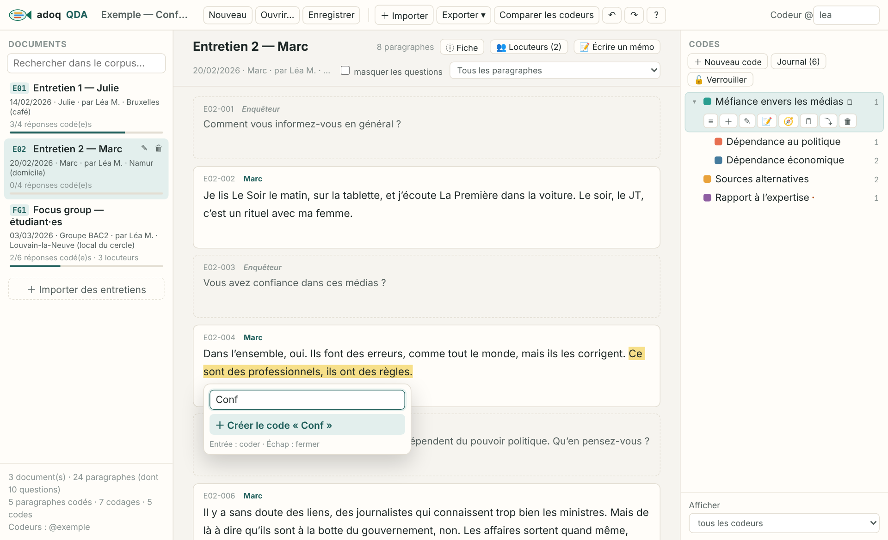

Sélectionnez ensuite « Dans l’ensemble, oui » et appuyez directement sur `Entrée` : le dernier code utilisé est proposé en premier.

Le passage codé est surligné et une étiquette apparaît sous le paragraphe. Un même passage peut recevoir plusieurs codes ; les barres de couleur s’empilent.

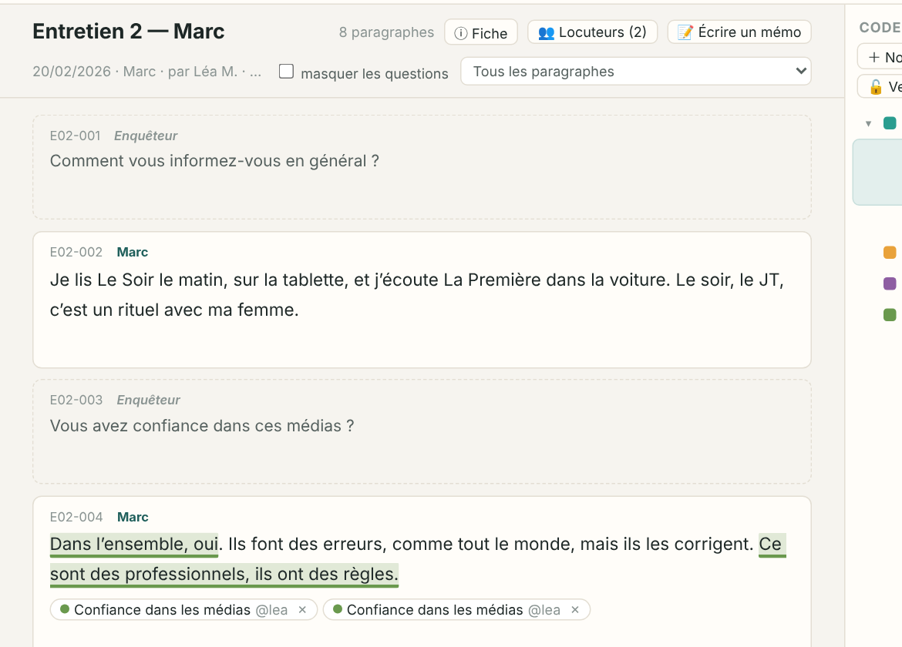

### 3. Organiser les codes

Dans la colonne de droite, **cliquez sur un code** : ses actions apparaissent (≡ extraits, ＋ sous-code, ✎ renommer, 📝 définition, 🗒 mémo, ⤵ fusionner, 🗑 supprimer). **Glissez-déposez** un code sur un autre pour l’y ranger. Écrivez la **définition** du code que vous venez de créer : le petit point orange disparaît.

### 4. Relire ses extraits

**Double-cliquez** sur « Méfiance envers les médias » : tous les passages qui portent ce code s’affichent, dans leur contexte. Cochez « inclure les sous-codes », puis « Exporter en .md » pour récupérer ces extraits dans un fichier.

### 5. Explorer le focus group

Ouvrez **Focus group — étudiant·es** : chaque prise de parole porte le pseudo de son auteur·e. Choisissez un participant dans le menu « Tous les locuteurs », ou cochez « masquer les questions ». Le bouton **👥 Locuteurs** montre les caractéristiques des participant·es et un tableau « Qui mobilise quels codes ? ».

### 6. Enregistrer

Cliquez sur **Enregistrer** et choisissez un emplacement. Vous savez l’essentiel : passez à la préparation de vos propres entretiens.


---


## Préparer ses retranscriptions

Un peu de rigueur dans la retranscription fait gagner beaucoup de temps à l’import.

### Formats acceptés

- **Word (`.docx`)** et **texte brut (`.txt`)**, en UTF-8 ou en encodage Windows ;
- du **texte collé** directement dans la fenêtre d’import ;
- le format **Iramuteq** (`**** *ID_…`).

Les formats `.doc`, `.odt` et `.pdf` ne sont pas lus : enregistrez votre fichier en `.docx` ou `.txt`.

### Un paragraphe par prise de parole

Chaque **paragraphe** devient une **unité de codage**. Séparez les prises de parole par une **ligne vide** (dans Word : un simple retour à la ligne suffit, chaque paragraphe Word devient un paragraphe).

### La règle des locuteurs

Pour un **entretien individuel**, ne nommez que l’intervieweur·euse : **chaque question commence par son prénom suivi de deux-points**. Les réponses ne portent aucune mention.

```text
Zoé : Comment vous informez-vous en général ?

Surtout par la radio, le matin, dans la voiture.

Le soir, je regarde parfois le JT avec mes parents.

Zoé : Et les réseaux sociaux ?

Très peu. Je m’en méfie.
```

À l’import, l’application repère « Zoé », la classe comme **intervieweuse**, retire son nom du texte et **vous demande le pseudo de la personne interviewée** : tous les paragraphes sans nom lui sont attribués.

Pour un **focus group**, commencez **chaque prise de parole** par le pseudo de la personne qui parle :

```text
Animatrice : D’où vient l’info que vous voyez passer ?

Inès : De TikTok, surtout.

Hugo : Pareil, mais je vérifie sur le site de la RTBF.
```

Un paragraphe sans nom prolonge alors la prise de parole précédente.

> **Variantes reconnues** — `Zoé :`, `[Zoé]`, `Q.`, `R.`, et un horodatage avant le nom (`[00:12:33] Zoé : …`). Les variantes d’écriture (`Int.`, `INT`) sont regroupées. Un « Zoé : » au milieu d’un paragraphe n’est pas pris pour un changement de locuteur.

### Anonymiser avant d’importer

Remplacez les noms réels par des **pseudos** dans la retranscription elle-même, ainsi que les lieux ou détails qui permettraient d’identifier une personne. Le texte n’est plus modifiable une fois importé : **relisez votre retranscription avant**.


---


## Importer des entretiens

Cliquez sur **＋ Importer** (en haut) ou **＋ Importer des entretiens** (à gauche). Vous pouvez choisir plusieurs fichiers à la fois, les **glisser-déposer** dans la fenêtre, ou **coller** un texte.

Pour chaque document, l’aperçu montre le nombre de paragraphes, les premières lignes, et trois réglages.

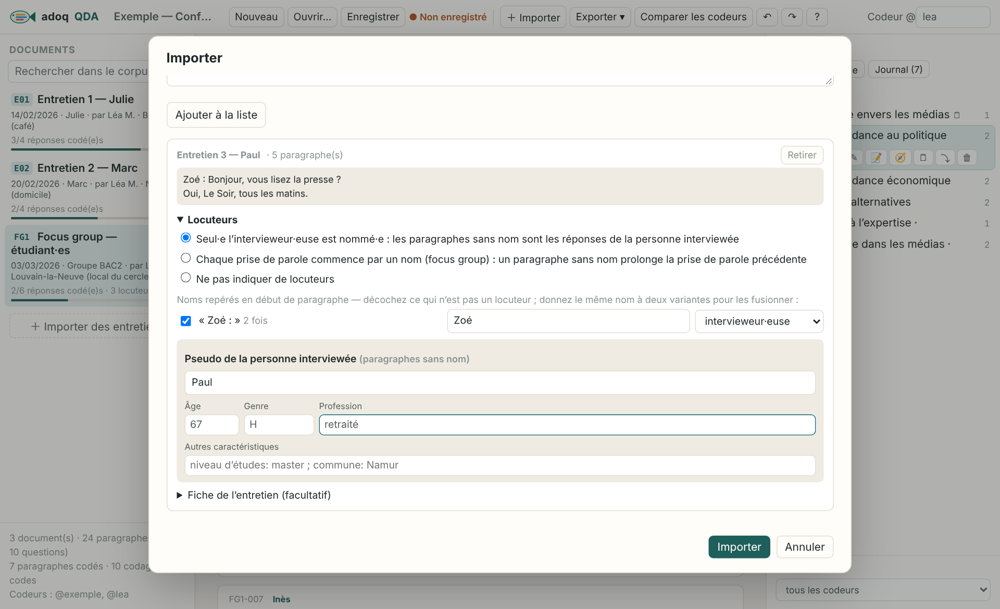

### Locuteurs

Choisissez comment attribuer les paragraphes :

1. **Seul·e l’intervieweur·euse est nommé·e** — les paragraphes sans nom sont les réponses de la personne interviewée. C’est le choix proposé pour un entretien individuel préparé selon la règle.
2. **Chaque prise de parole commence par un nom** — pour les focus groups.
3. **Ne pas indiquer de locuteurs** — proposé pour un corpus Iramuteq (chaque paragraphe vient d’une personne différente).

La liste des **noms repérés** en début de paragraphe permet de décocher une fausse détection, de corriger un nom, ou de fusionner deux variantes en leur donnant le même nom. Le **rôle** (intervieweur·euse ou répondant·e) est deviné et modifiable.

### Pseudo et caractéristiques

Pour la personne interviewée, indiquez son **pseudo** (à défaut : « Répondant ») et ses **caractéristiques** : âge, genre, profession, et toute autre information sous la forme `niveau d’études: master ; commune: Namur`. En focus group, chaque participant·e nommé·e a ses propres caractéristiques.

Ces caractéristiques s’affichent au survol du nom du locuteur et sont reprises dans les extraits et les exports CSV, ce qui permet de croiser les codes avec l’âge ou le genre.

### Fiche de l’entretien

Facultative : **date**, **pseudo** de la personne interviewée, **intervieweur·euse**, **lieu**. Elle reste modifiable ensuite par le bouton **ⓘ Fiche**, qui permet aussi d’ajouter d’autres champs (durée, contexte…).

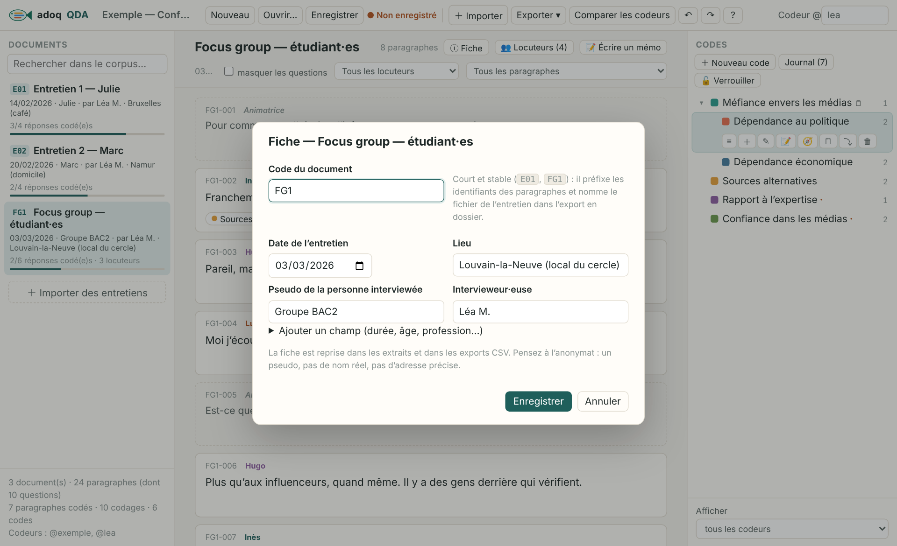

### Après l’import

Le bouton **👥 Locuteurs** du document permet à tout moment de renommer ou fusionner des locuteurs, de changer leur rôle, de compléter leurs caractéristiques, et d’attribuer après coup les paragraphes restés sans locuteur. Les codages déjà faits sont conservés. Pour corriger un seul paragraphe, **cliquez sur le nom du locuteur** au-dessus du texte.

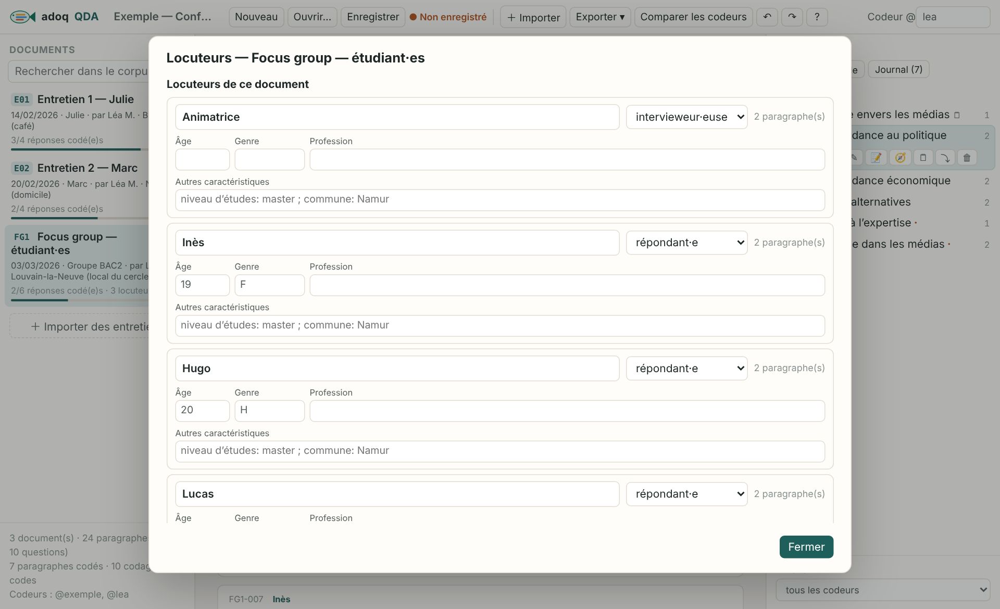

### Importer un projet QDA-md

L’onglet **Projet QDA-md** de la fenêtre **＋ Importer** ajoute au projet ouvert un projet entier :

- un **dossier** de projet QDA-md (version de recherche) ou un projet adoq exporté en dossier, qui contient `arbre.md` et `donnees/` ;
- une **archive `.zip`** de ce dossier ;
- un autre fichier **`.qda.md`**.

Un aperçu indique ce qui sera ajouté : documents, codes, codages. Rien n’est effacé dans votre projet : un entretien déjà présent reçoit seulement les codages qui lui manquent, et un code déjà présent garde sa définition. L’import est noté dans le journal de l’arbre de codes.

Les projets de l’ancien format QDA-md (0.9) sont convertis au passage. Les notes placées sous les codes de leur arbre deviennent des mémos de codes.


---


## Coder

### Appliquer un code

1. **Sélectionnez un passage** à l’intérieur d’un paragraphe.
2. Dans la fenêtre qui s’ouvre, **choisissez un code** (flèches et `Entrée`, ou clic), ou **tapez un nom** pour créer un nouveau code.
3. Le **dernier code utilisé** reste en tête de liste : sélection + `Entrée` suffit pour le réappliquer.

Pour coder tout un paragraphe, survolez-le et cliquez sur **＋ paragraphe entier** ; une barre de couleur apparaît dans la marge.


### Plusieurs codes, chevauchements

Un même passage peut recevoir plusieurs codes, et deux passages codés peuvent se chevaucher. Chaque code a sa couleur ; quand plusieurs codes se superposent, leurs barres s’empilent sous le texte.

### Retirer un code

Sous chaque paragraphe, les **étiquettes** montrent les codes appliqués ; dès que le projet compte plusieurs codeurs, chaque étiquette indique aussi qui a codé (`@zoe`). **Survolez** une étiquette pour voir le passage concerné ; cliquez sur **×** pour retirer le code. Toute opération peut être annulée avec `Ctrl+Z` (rétablie avec `Ctrl+Y`).

### Questions et réponses

Les questions de l’intervieweur·euse apparaissent **en pointillés**. On ne les code généralement pas : cochez **masquer les questions** pour ne voir que les réponses. Le filtre « Pas encore codés » ignore lui aussi les questions.

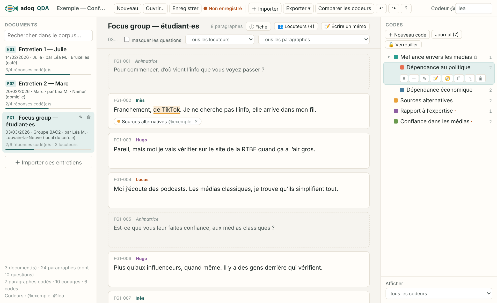

### Se repérer

- **Filtres** en haut du document : paragraphes portant le code actif, paragraphes pas encore codés, un locuteur précis (focus group).
- **Afficher** (en bas de la colonne des codes) : tous les codeurs, seulement vos codages, ou ceux d’un·e autre codeur·euse — voir Travailler à plusieurs.
- **Recherche** dans tout le corpus (colonne de gauche) : un clic sur un résultat ouvre le paragraphe.
- **Mémo du document** (📝) : impressions, contexte de l’entretien, premières pistes d’analyse.
- La **barre d’avancement** de chaque document compte les réponses codées.


---


## L’arbre de codes

Les codes sont rangés en **arbre** : un code peut avoir des sous-codes. Cliquez sur un code pour le rendre **actif** et afficher ses actions.

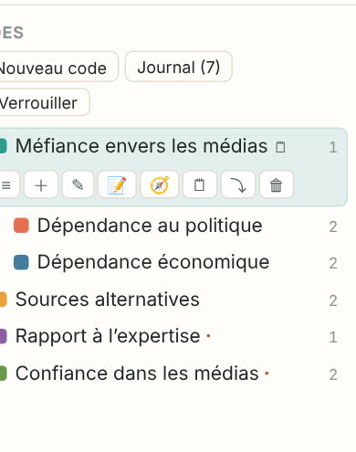

| Action | Effet |
|---|---|
| ≡ | Voir les **extraits** du code (aussi par double-clic) |
| ＋ | Ajouter un **sous-code** |
| ✎ | **Renommer** (l’identifiant dans le fichier ne change pas : les codages restent attachés) |
| 📝 | Écrire la **définition** |
| 🧭 | Noter l’**origine** du code : inductive ou déductive |
| 🗒 | Écrire le **mémo** du code |
| ⤵ | **Fusionner** dans un autre code : tous ses codages passent au code choisi |
| 🗑 | **Supprimer** : ses codages sont retirés, ses sous-codes remontent d’un niveau |

**Réorganiser** : glissez un code sur un autre — au milieu de la ligne pour l’y ranger comme sous-code, au-dessus ou en dessous pour le placer à côté. La zone « Déposer ici… » le remet au premier niveau.

### Définition et mémo

- La **définition** dit *quand appliquer le code* : ce qu’il désigne, un exemple typique, ce qui n’en relève pas. Elle garantit un codage constant et rend la comparaison entre codeurs possible. Un **point orange** signale un code sans définition.
- Le **mémo** recueille vos *réflexions d’analyse* sur ce code : interprétations, hypothèses, liens avec vos lectures, cas limites. Il évolue librement.

### Origine des codes : inductif ou déductif

Un code peut naître de deux façons :

- **inductif** : il est apparu en lisant les entretiens, sans avoir été prévu ;
- **déductif** : il vient de la théorie, d’une hypothèse ou de la question de recherche, et on l’a cherché dans les données.

Le bouton **🧭** permet de le noter, avec, si on veut, la théorie ou l’auteur·e de référence d’un code déductif. Une pastille apparaît devant le nom du code : **I** pour inductif, **D** pour déductif ; le survol rappelle la théorie. L’origine est reprise dans le livre de codes exporté.

Distinguer les deux aide à voir ce que l’analyse doit à la théorie de départ et ce qu’elle doit aux données. C’est aussi la première étape du codage abductif, que propose QDA-md, la version de recherche.

Dans le fichier, l’origine est écrite sous le code, comme dans QDA-md :

```markdown
- Stratégies de vérification #verification
  origine:: deductif
  theorie:: Wardle
  > La personne décrit ce qu'elle fait pour vérifier une information.
```

Changer l’origine est noté dans le journal. Comme la définition, elle ne peut plus être modifiée quand l’arbre est verrouillé.

### Le journal de l’arbre

Le bouton **Journal** liste toutes les opérations sur l’arbre — création, renommage, définition, imbrication, fusion, suppression — avec la date et l’auteur·e. Un **motif** peut être indiqué au moment de la fusion ou de la suppression, ou ajouté ensuite. Au moment de rédiger, ce journal permet de raconter comment votre grille d’analyse s’est construite.

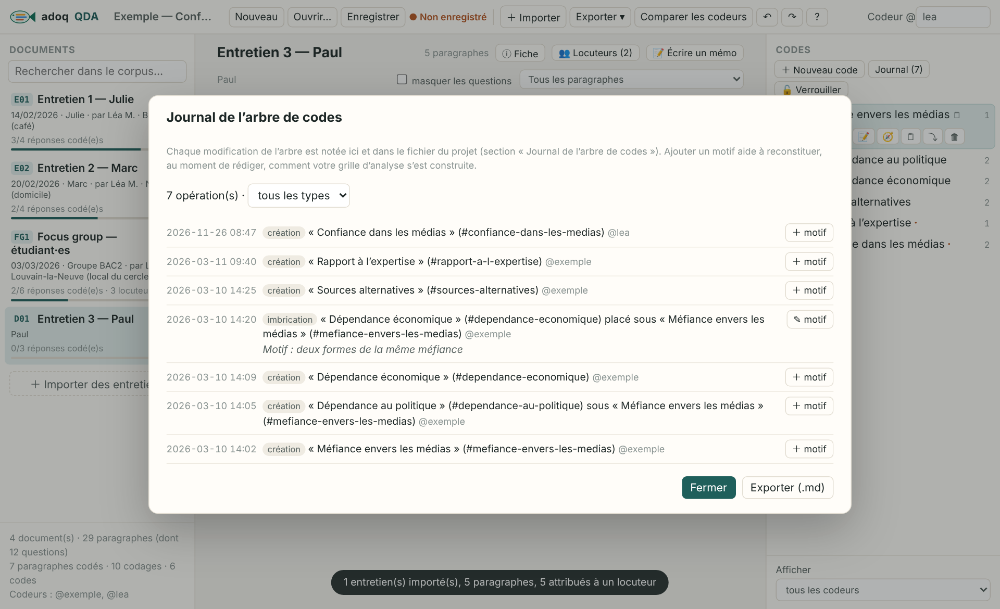

### Verrouiller l’arbre

Le bouton **🔓 Verrouiller** fige l’arbre : on peut encore coder avec les codes existants et écrire des mémos, mais plus créer, renommer, définir, déplacer, fusionner ou supprimer de codes. Un **code de déverrouillage** est facultatif.

C’est utile quand l’enseignant·e distribue un **livre de codes imposé**, ou quand un binôme a stabilisé son arbre avant de coder chacun de son côté.

> **Un verrou pédagogique** — Le fichier projet reste un texte modifiable à la main : le verrou évite les modifications par erreur, pas un contournement volontaire. N’utilisez **jamais** un vrai mot de passe comme code de déverrouillage.


---


## Extraits et exports

### Extraits d’un code

Double-cliquez sur un code (ou ≡) : tous les passages qui le portent s’affichent **dans leur contexte**, avec le document, le paragraphe, le locuteur et le codeur. Vous pouvez inclure les sous-codes, filtrer par codeur, et revenir au texte d’un clic. La définition et le mémo du code sont rappelés en tête.

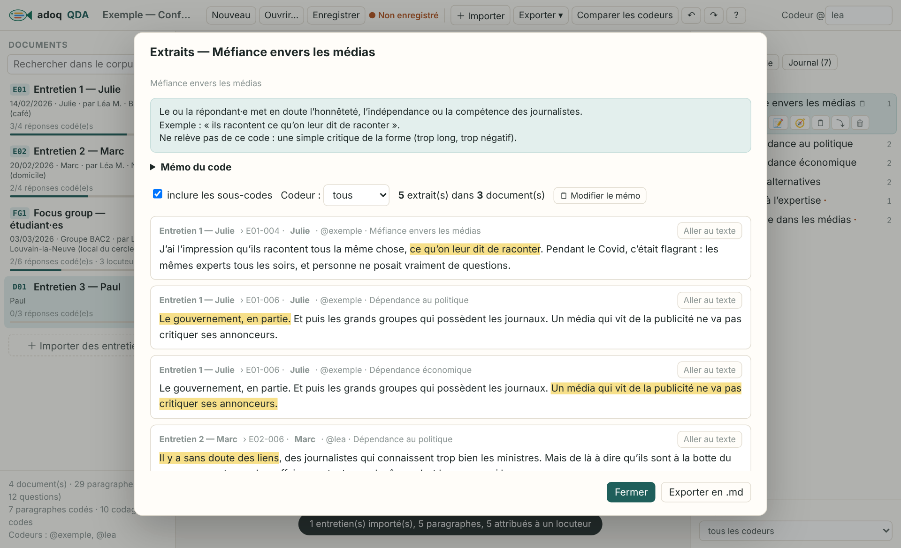

**Exporter en .md** produit un fichier lisible (dans Word, Obsidian, un éditeur de texte) que l’on peut citer directement dans un travail : définition, mémo, puis les extraits regroupés par entretien, avec la fiche de l’entretien et les caractéristiques des locuteurs.

### Le menu Exporter

| Export | Contenu | Pour quoi faire |
|---|---|---|
| Enregistrer une copie du projet | le fichier `.qda.md` complet | sauvegarder, rendre son travail, transmettre à un·e collègue |
| Projet en dossier (`.zip`) | le même projet en dossier : `arbre.md` et un fichier par entretien dans `donnees/` | travailler dans QDA-md ou Obsidian, archiver un entretien par fichier |
| Livre de codes (`.md`) | l’arbre, les définitions et les mémos, avec le nombre de codages | annexe d’un mémoire |
| Segments codés (`.csv`) | une ligne par code appliqué : document et son code, fiche, paragraphe, variables Iramuteq, locuteur et ses caractéristiques, code, codeur, citation | analyses dans un tableur, R ou SPSS |
| Matrice documents × codes (`.csv`) | nombre de codages par entretien et par code | comparer les entretiens |
| Matrice locuteurs × codes (`.csv`) | nombre de paragraphes de chaque locuteur portant chaque code, avec ses caractéristiques | focus groups, croisements par âge ou genre |

Les fichiers CSV utilisent le point-virgule comme séparateur et s’ouvrent directement dans Excel ou LibreOffice. Une cellule qui commence par `=`, `+`, `-` ou `@` est précédée d’une apostrophe, pour qu’un tableur ne la prenne pas pour une formule.


---


## Travailler à plusieurs

Le **double codage** est un exercice central de l’apprentissage : deux personnes codent le même matériau séparément, puis confrontent leurs choix. adoq QDA l’organise en trois temps, dans **Comparer les codeurs**.

### 0. Coder chacun·e de son côté

Chacun·e travaille dans **sa copie du projet**, avec **son propre identifiant**. Dans le menu **Afficher** (en bas de la colonne des codes), choisissez **mes codages — codage à l’aveugle** pour ne pas être influencé·e par les codages déjà présents.

> **Partir d’une même base** — Le plus simple : une personne crée le projet, importe les entretiens, écrit les premières définitions (et éventuellement verrouille l’arbre), puis envoie une copie du fichier à l’autre.

### 1. Fusionner la copie d’un·e collègue

Ouvrez l’onglet **1. Fusionner** et choisissez le fichier `.qda.md` de votre collègue. Un aperçu indique ce qui sera ajouté : codages, codes, mémos, entrées du journal. La fusion **n’efface jamais rien** et ne crée pas de doublons : la refaire ne change rien. Si les deux copies portent le même identifiant, l’application propose de le renommer.

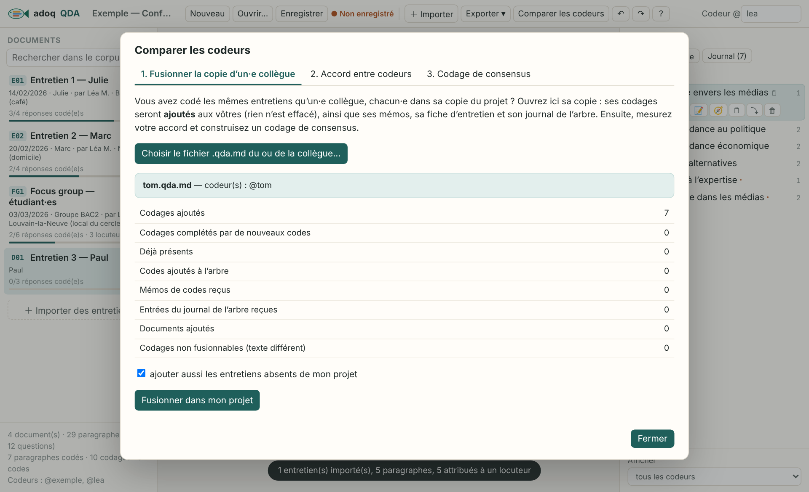

### 2. Mesurer l’accord

L’onglet **2. Accord entre codeurs** calcule, pour chaque code, le **kappa de Cohen** au niveau du paragraphe : pour chaque paragraphe, le code est-il présent chez l’un, chez l’autre, chez les deux, chez aucun ? Les questions de l’intervieweur·euse sont exclues. Cliquez sur une ligne pour voir les **désaccords** et aller au texte.

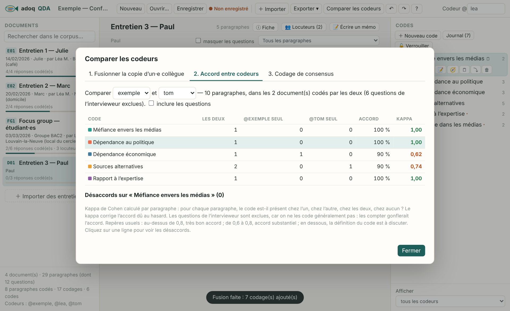

Repères usuels : au-dessus de **0,8**, très bon accord ; de **0,6 à 0,8**, accord substantiel ; en dessous, la définition du code est à discuter.

### 3. Construire un codage de consensus

L’onglet **3. Codage de consensus** présente chaque point à trancher — un paragraphe et un code, proposé par l’un, l’autre ou les deux. Pour chacun : **Garder** ou **Écarter**. Les accords peuvent être repris d’un coup. Le résultat est signé **@consensus** ; les codages de départ restent intacts.

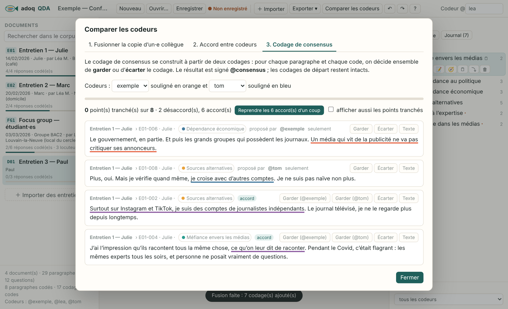

### Afficher le codage d’une personne

Le menu **Afficher** propose : **tous les codeurs**, **mes codages**, ou n’importe quel codeur du projet — y compris **@consensus**. Vous continuez à coder sous votre propre identifiant ; un rappel s’affiche sous le menu, car vos nouveaux codages restent invisibles tant qu’un autre codeur est affiché.

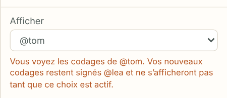

Pour **retoucher** le consensus lui-même, prenez temporairement l’identifiant `consensus` (« Codeur @ »), puis reprenez le vôtre.


---


## Vue enseignant

La **vue enseignant** (lien sur la page d’accueil, ou menu **Exporter › Vue enseignant…**) réunit les fichiers `.qda.md` rendus par un groupe. Les fichiers sont lus dans le navigateur ; rien n’est modifié.

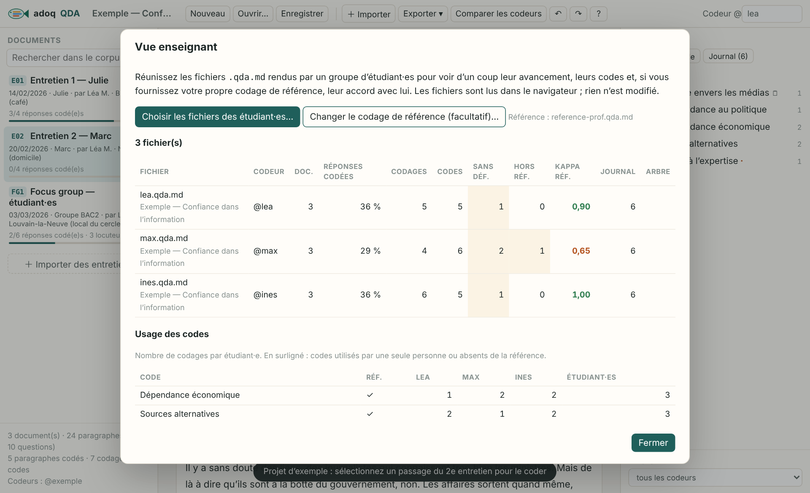

1. **Choisir les fichiers des étudiant·es** (plusieurs à la fois).
2. Facultatif : **choisir le codage de référence**, c’est-à-dire votre propre codage du même corpus.

Pour chaque étudiant·e : la part des réponses codées, le nombre de codages et de codes, les **codes sans définition**, les **codes absents de la référence** et le **kappa moyen avec la référence**. Le tableau « Usage des codes » montre qui utilise quoi et met en évidence les codes isolés.

**Ouvrir la synthèse du groupe** crée un projet qui réunit tous les codages, chacun signé par son auteur·e (les identifiants en double sont renommés) : idéal pour **projeter les désaccords en séance**. **Exporter le tableau** produit un fichier CSV.

### Un scénario de travaux pratiques

1. **Préparer** un projet avec deux ou trois entretiens courts, un arbre de codes et ses définitions ; le **verrouiller** avec un code.
2. **Distribuer** le fichier `.qda.md` et le fichier de l’application.
3. Les étudiant·es **codent à l’aveugle**, chacun·e avec son identifiant, puis rendent leur fichier.
4. En séance, **ouvrir la vue enseignant** avec votre codage de référence ; projeter la synthèse et discuter les codes au kappa faible.
5. Par binômes, **fusionner** les copies et construire un **codage de consensus**.
6. Variante inductive : laisser l’arbre déverrouillé et comparer, grâce au **journal**, la manière dont chaque binôme a construit sa grille.


---


## Le fichier projet `.qda.md`

Un projet est un **simple fichier texte** au format Markdown. On peut l’ouvrir dans le Bloc-notes, TextEdit, VS Code ou Obsidian pour voir comment le codage est noté. L’application le relit et l’écrit ; un humain peut le lire, et même le corriger à la main.

Le format s’appelle **qda.md**, version 1 : sa version est indiquée en tête du fichier (`qda-format: 1`). Il est commun à adoq QDA et à **QDA-md**, la version de recherche : un projet passe de l’un à l’autre sans conversion.

### Pourquoi un format ouvert ?

Les logiciels d’analyse qualitative enferment souvent le travail de codage dans des fichiers que seul le logiciel sait lire. Si le logiciel change, devient payant ou disparaît, le codage devient difficile à relire, à partager ou à archiver. Le format qda.md propose une autre voie : un projet de codage écrit en **Markdown**, c’est-à-dire en texte brut.

- **Lisible par un humain.** Le fichier s’ouvre dans n’importe quel éditeur de texte. On y lit l’arbre de codes, chaque codage (une ligne signée par son codeur, liée à une citation exacte), les mémos et le journal de la grille.
- **Utilisable dans Obsidian.** Les encadrés repliables cachent le codage quand on veut lire le texte seul, et chaque paragraphe a un identifiant auquel on peut faire un lien.
- **Traitable par un programme sans ambiguïté.** La structure est décrite dans une spécification publique : un autre logiciel, ou un script, peut lire et écrire les mêmes fichiers.
- **Le texte des entretiens n’est jamais modifié** par le codage : chaque codage désigne son passage par une citation, pas par une position.
- **Un fichier ou un dossier**, au choix : tout le projet dans un seul fichier, ou un fichier par document et un fichier commun pour l’arbre de codes. On passe de l’un à l’autre sans rien perdre.
- **Pérenne et transparent.** Un fichier texte reste lisible dans des décennies. Il se dépose tel quel dans un entrepôt de données, avec le corpus, ce qui rend l’analyse vérifiable et réutilisable, dans l’esprit de la science ouverte.

Le format est présenté en détail, avec ses raisons et ses limites, dans le document de travail de Lits (2026). Sa spécification est publiée sur [github.com/MiiL-UCLouvain/qdamd-format](https://github.com/MiiL-UCLouvain/qdamd-format).

### À quoi ressemble un projet

```markdown
---
qda-format: 1
id: memoire-info-2026
titre: Mémoire — rapport à l’information
---

# Arbre de codes

- Méfiance envers les médias #mefiance
  > Le répondant met en doute l’indépendance des journalistes.
  - Dépendance au politique #dependance-politique

# Documents

## Entretien avec Julie
document:: E01

> [!meta]- Fiche de l'entretien
> date:: 2026-02-14
> lieu:: Bruxelles

> [!locuteurs]- Locuteurs
> - Zoé :: intervieweur
> - Julie :: répondant :: âge: 24 ; genre: F

### E01-002
locuteur:: Julie

Ils sont à la solde des politiciens, c’est évident.

> [!codage]-
> - #dependance-politique @zoe : « à la solde des politiciens »
```

### Ce qu’il faut savoir

- **Le texte des entretiens n’est jamais modifié** par le codage. Chaque codage cite le passage codé ; `[2]` désigne la deuxième occurrence d’une même citation ; `(paragraphe entier)` code tout le paragraphe.
- **Chaque document a un code** (`E01`, `FG1`), modifiable dans **ⓘ Fiche**, et **chaque paragraphe un identifiant stable** (`E01-002`). Renommer un document ou un locuteur ne change pas ces identifiants : un lien Obsidian comme `[[mon-projet.qda#E01-002]]` reste valable.
- **Chaque code a un identifiant** (`#mefiance`) qui ne change pas quand on le renomme. Sous la ligne du code peuvent venir des champs, comme son origine (`origine:: inductif` ou `origine:: deductif`, et `theorie::`), puis sa définition (lignes `>`).
- Chaque paragraphe tient sur **une seule ligne**. Une ligne qui pourrait être lue comme autre chose que du texte (elle commence par `-`, `#`, `1.`…) est précédée d’une barre oblique inverse `\`, retirée à la lecture.
- D’autres sections apparaissent au besoin : `# Mémos des codes`, `# Décisions de consensus`, `# Journal de l'arbre de codes`. Un paragraphe peut aussi porter un mémo (`> [!memo]-`), affiché sous son texte.
- Une citation qui ne se retrouve plus dans le texte est signalée **⚠** mais jamais perdue ; une ligne illisible est conservée telle quelle. Ce que le logiciel ne connaît pas (un champ, un encadré, une section ajoutés par QDA-md ou à la main) est **recopié à l’identique**.

### Un fichier ou un dossier

Par défaut, adoq QDA travaille sur **un seul fichier** `.qda.md`. Le même projet peut aussi prendre la forme d’un **dossier**, celle qu’utilise QDA-md :

```
mon-projet/
  arbre.md          ← l’en-tête et les sections du projet
  donnees/
    E01.md          ← un fichier par entretien
    E02.md
    FG1.md
```

- **Exporter › Projet en dossier** télécharge ce dossier dans une archive `.zip`.
- **Importer › Projet QDA-md** fait le chemin inverse : il lit un dossier, une archive `.zip` ou un autre fichier `.qda.md`, et ajoute son contenu au projet ouvert.

Le passage de l’un à l’autre ne perd rien : découper un fichier en dossier puis le réunir redonne le même fichier.

### Projets créés avec une version antérieure

Un projet créé avec QDA-md Étude ou adoq QDA 0.3 (en-tête `qda-md-etude: 2`) est **converti à l’ouverture**, après confirmation : chaque document reçoit un code (`D01`, `D02`…) et chaque paragraphe un identifiant (`D01-004`). Le texte et le codage ne changent pas. Une copie de l’ancien fichier est gardée dans les sauvegardes du navigateur, et peut être téléchargée.

> **Après la conversion** — N’ouvrez plus le projet avec adoq QDA 0.3 ou une version antérieure : elles ne comprennent pas le format qda.md et abîmeraient le fichier en l’enregistrant.

Les projets de **QDA-md 0.9** (version de recherche, ancien format) s’importent aussi par **Importer › Projet QDA-md**. Les notes placées sous les codes de leur arbre deviennent des **mémos** de codes ; leur définition reste à écrire.

### Glossaire

Code
:   Étiquette appliquée à un passage pour signaler qu’il relève d’un thème, d’une catégorie ou d’un concept.

Arbre de codes (livre de codes)
:   L’ensemble organisé des codes, avec leurs définitions.

Segment, codage
:   Un passage précis auquel un ou plusieurs codes ont été appliqués, par un codeur donné.

Locuteur
:   La personne qui prend la parole dans un paragraphe ; son rôle est intervieweur·euse, répondant·e, participant·e (focus group) ou autre.

Code du document, identifiant de paragraphe
:   Repères stables du format qda.md (`E01`, `E01-004`), qui ne dépendent ni du titre ni de la position.

Kappa de Cohen
:   Mesure de l’accord entre deux codeurs, corrigée de l’accord attendu par le hasard (1 = accord parfait, 0 = pas mieux que le hasard).

Consensus
:   Codage commun construit en tranchant les désaccords entre deux codeurs, signé `@consensus`.


---


## Données et confidentialité

### Où sont mes données ?

- **Dans votre fichier projet** `.qda.md`, à l’endroit où vous l’avez enregistré. C’est la **seule version de référence** de votre travail.
- **Nulle part ailleurs sur internet** : l’application n’envoie aucune donnée, ne charge aucune ressource extérieure et fonctionne hors ligne.

### Les copies gardées par le navigateur

Pour éviter les pertes, le navigateur garde aussi :

- une **reprise du travail non enregistré** (proposée sur la page d’accueil après une fermeture accidentelle) ;
- jusqu’à **20 sauvegardes automatiques** par projet, que l’on peut rouvrir ou télécharger ;
- la liste des projets récents, votre identifiant et vos réglages.

Les copies contiennent le **texte complet des entretiens**. Elles sont enregistrées **sur le disque**, dans le profil du navigateur, et restent après la fermeture de l’onglet. Les sites web ordinaires n’y ont pas accès, mais **d’autres fichiers HTML ouverts depuis l’ordinateur dans le même navigateur** pourraient les lire, et toute personne utilisant la même session de l’ordinateur peut les retrouver.

### Effacer les données du navigateur à la fermeture

La page d’accueil et le menu **Exporter › Sauvegardes et données du navigateur…** posent la question : **« Effacer les données de ce navigateur quand on ferme adoq QDA ? »**

- **Non** — sur votre ordinateur personnel : copies de secours et reprise du travail restent disponibles.
- **Oui** — sur un **ordinateur partagé** ou avec des **données sensibles** : les données existantes sont effacées immédiatement, **aucune copie n’est plus gardée** pendant le travail, et identifiant, réglages et projets récents sont effacés à la fermeture. Seul ce choix lui-même est mémorisé.

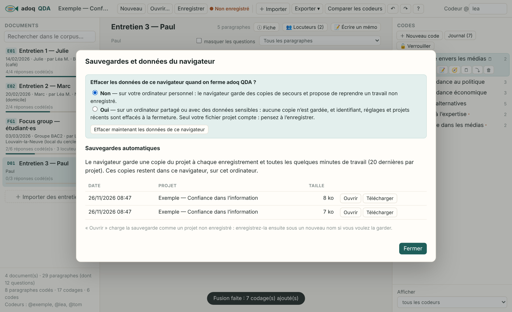

Le bouton **Effacer maintenant les données de ce navigateur** fait le ménage à tout moment. Vos **fichiers projet** ne sont jamais touchés.

> **Avec « Oui », seul votre fichier compte** — Sans copie de secours, un travail non enregistré est perdu si l’onglet se ferme. Avec Chrome ou Edge, l’enregistrement automatique dans le fichier protège ; avec Firefox ou Safari, enregistrez souvent.

### Bonnes pratiques

- **Anonymisez** les retranscriptions avant l’import : pseudos, lieux, détails identifiants.
- Rangez le fichier projet dans un **dossier sauvegardé** (OneDrive de l’université, par exemple) et faites-en des copies datées aux étapes importantes.
- **N’ouvrez pas de fichiers HTML d’origine inconnue** dans le navigateur qui vous sert à coder.
- Ouvrez des **exports CSV** venant d’autres personnes avec prudence dans Excel (une cellule commençant par `=` peut contenir une formule).
- Ne téléchargez l’application **que depuis cette page** : une version modifiée qui circulerait entre étudiant·es pourrait, elle, envoyer des données.


---


## Questions fréquentes

**Je ne retrouve pas mon travail.**
:   Rouvrez votre fichier `.qda.md` avec **Ouvrir un projet**. Avec Firefox ou Safari, ouvrez le **dernier** fichier téléchargé. Sinon, regardez la page d’accueil (« Un travail non enregistré a été retrouvé ») et **Exporter › Sauvegardes et données du navigateur…** (sauf si vous avez choisi d’effacer les données à la fermeture).

**L’indicateur reste sur « ● Non enregistré ».**
:   Avec Firefox ou Safari, c’est normal tant que vous n’avez pas cliqué sur **Enregistrer**. Avec Chrome ou Edge, cliquez sur Enregistrer une fois pour choisir l’emplacement du fichier ; ensuite l’enregistrement est automatique.

**Mon fichier Word est mal découpé.**
:   Chaque paragraphe Word devient une unité. Vérifiez que chaque prise de parole est un paragraphe distinct (pas de retours à la ligne forcés au milieu d’une réponse). Pour un `.txt`, séparez les prises de parole par une ligne vide.

**Les questions ne sont pas reconnues.**
:   Chaque question doit commencer par le nom de l’intervieweur·euse suivi de deux-points (`Zoé : …`). Vous pouvez corriger après coup avec **👥 Locuteurs**, ou cliquer sur le nom du locuteur d’un paragraphe.

**Je ne peux pas sélectionner un passage sur deux paragraphes.**
:   C’est voulu : un codage appartient à un seul paragraphe. Codez les deux passages séparément, avec le même code.

**Je ne peux plus créer de code.**
:   L’arbre est **verrouillé** (🔒 en haut de la colonne des codes). Demandez le code de déverrouillage à la personne qui a préparé le projet.

**Je ne vois plus mes nouveaux codages.**
:   Le menu **Afficher** (en bas de la colonne des codes) montre peut-être le codage d’un·e autre codeur·euse. Choisissez « tous les codeurs » ou « mes codages ».

**Puis-je ouvrir mon projet dans MaxQDA ou NVivo ?**
:   Pas directement pour l’instant. Les exports CSV et Markdown sont lisibles partout ; un export au format d’échange REFI-QDA est envisagé.

**Puis-je modifier le texte d’un entretien après l’import ?**
:   Pas dans l’application. Pour corriger une coquille, on peut modifier le texte dans le fichier `.qda.md` avec un éditeur de texte ; un codage dont la citation ne se retrouve plus est signalé ⚠ sans être perdu.


---


## À propos, licence et citation

### Auteur

adoq QDA est créé par **Grégoire Lits**, chercheur au **Media Innovation and Intelligibility Lab (MiiL)** de l’UCLouvain (Institut Langage et Communication).

Jusqu’à la version 0.2.2, le logiciel s’appelait *QDA-md Étude*. « adoq » vient d’*analyse de données qualitatives* ; QDA est l’abréviation anglaise de la même expression (*qualitative data analysis*).

### Code source

- **Application** : [github.com/MiiL-UCLouvain/adoqQDA](https://github.com/MiiL-UCLouvain/adoqQDA). On y trouve le code, les tests, les versions à télécharger et le journal des versions. C’est aussi là que l’on signale un problème ou que l’on propose une amélioration.
- **Format qda.md** : [github.com/MiiL-UCLouvain/qdamd-format](https://github.com/MiiL-UCLouvain/qdamd-format). On y trouve la spécification du format et des projets d’exemple.

### Licence

adoq QDA est publié sous la licence **EUPL-1.2** (*European Union Public Licence*, version 1.2), une licence libre de l’Union européenne. Vous pouvez utiliser le logiciel, l’étudier, le modifier et le redistribuer ; une version modifiée et redistribuée doit rester sous une licence compatible et mentionner les auteurs d’origine. Le texte complet est sur le site de la [Commission européenne](https://interoperable-europe.ec.europa.eu/collection/eupl/eupl-text-eupl-12) et dans le fichier `LICENSE` du dépôt.

### Citer adoq QDA et le format qda.md

Si vous utilisez adoq QDA ou le format qda.md dans un travail (mémoire, article, rapport), citez le document de travail qui présente le format :

> Lits, G. (2026). *qda.md : un format ouvert, lisible et pérenne pour les données qualitatives codées* (Working paper du MiiL 1). [https://hdl.handle.net/2078.5/282719](https://hdl.handle.net/2078.5/282719)

Dans un mémoire, il est aussi utile de préciser la version du logiciel utilisée (elle figure dans le nom du fichier, par exemple `adoq-QDA-0.4.3.html`) et de joindre ou de déposer le fichier projet `.qda.md` : il contient l’arbre de codes, les codages et le journal de la grille, ce qui rend l’analyse vérifiable.


---
